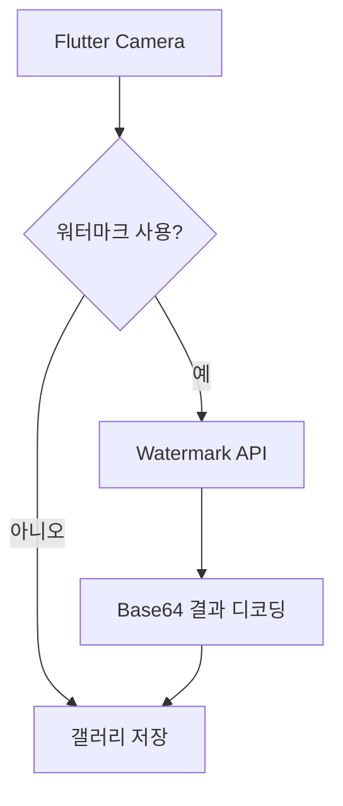

# SAFEcam

**촬영한 이미지에 서버 기반 워터마크 처리를 연결한 Flutter 카메라 프로토타입**

Flutter · Dart · Camera · HTTP · Image Processing

[연계 이미지 처리 API](https://github.com/0JDaEun/watermark_api) · [카메라 구현](lib/screen/camera_screen.dart)

## 프로젝트 목적

사진을 찍는 과정에 이미지 보호 기술을 결합하는 사용자 경험을 탐색한다. 일반 촬영과 워터마크 적용 촬영을 선택할 수 있고, 서버에서 반환된 처리 결과를 갤러리에 저장한다.

## 주요 기능

| 기능 | 설명 |
| --- | --- |
| 카메라 미리보기 | 기기의 카메라 초기화 및 화면 표시 |
| 카메라 전환 | 전·후면 등 사용 가능한 카메라 전환 |
| 보호 모드 | 워터마크 적용 여부 선택 |
| 이미지 처리 | 서버에 촬영 이미지 전송, Base64 결과 수신 |
| 사진 저장 | 처리 결과 또는 일반 촬영 결과를 갤러리에 저장 |

## 시스템 흐름



## 핵심 구현과 코드 구조

- [lib/main.dart](lib/main.dart): 앱 진입점.
- [lib/screen/camera_screen.dart](lib/screen/camera_screen.dart): 카메라 수명주기, 촬영, 이미지 처리 요청, 저장.
- [lib/widget](lib/widget): 공통 UI 요소.
- [pubspec.yaml](pubspec.yaml): Dart SDK 및 Flutter 패키지.

## 실행 준비

Dart 3.7 계열 이상 호환 Flutter 환경, 카메라·갤러리 권한 및 별도 이미지 처리 서버가 필요하다. 서버 URL은 현재 사용할 수 있는 안전한 서버로 설정해야 한다.

```bash
flutter pub get
flutter analyze
flutter test
flutter run
```

현재 소스 분석에 기반한 절차이며 실제 기기 실행은 재검증하지 않았다.

## 연구 범위와 한계

SAFEcam은 이미지 보호의 사용자 경험과 서버 연동을 구현한 프로토타입이다. 실제 딥페이크 방어 효과, 워터마크 강인성, 재압축 후 검출 성능은 검증되지 않았다. 사진 전송 시 개인정보 보호, 서버 보관·삭제 정책, 실패 복구 및 실제 기기 테스트가 필요하다.
